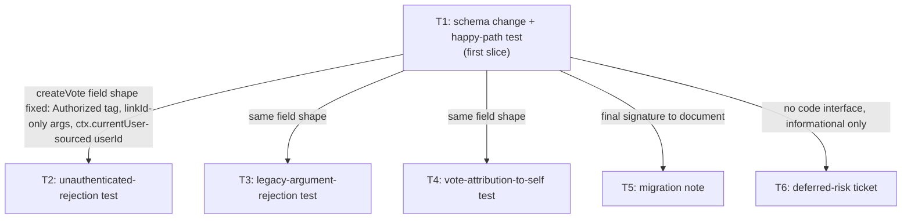

# Tasks: scope-createvote-to-session-user

Source: [plan.md](plan.md). 6 tasks, each a diff under 100 lines, each at most one afternoon.

**T1 — first slice — one AC end-to-end, < 100 lines.** Implement first; its folder/branch name is `T1`.

---

## T1 — Schema change + happy-path proof test

- **Input:** current `GraphQLSchema.scala` (`createVote` has `arguments = LinkIdArg :: UserIdArg :: Nil`, no `Authorized` tag, resolver reads `c.arg(UserIdArg)`).
- **Output:** `createVote` updated to `tags = Authorized :: Nil`, `arguments = LinkIdArg :: Nil`, resolver `c.ctx.dao.createVote(c.arg(LinkIdArg), c.ctx.currentUser.get.id)`; one new ScalaTest spec (`CreateVoteAuthSpec`) with a single test running `login(...) { id } createVote(linkId: 1) { id user { id } } }` as one document.
- **Done:** `sbt "testOnly *CreateVoteAuthSpec -- -z \"logged-in user can vote in the same document\""` passes — response has no top-level `errors` and `createVote.user.id` equals the logged-in user's id.

## T2 — Unauthenticated-rejection test

- **Input:** T1's merged `createVote` field (the `Authorized` tag is in place).
- **Output:** a new test in `CreateVoteAuthSpec` calling `createVote(linkId: 1)` with no `login` in the document.
- **Done:** the test passes, asserting a top-level error whose message matches `AuthorizationException`'s text, and that no new row exists in `VOTES` (count unchanged) after the call.

## T3 — Legacy-argument-rejection test

- **Input:** T1's merged schema (the `userId` argument is gone from `createVote`).
- **Output:** a new test submitting `createVote(linkId: 1, userId: 2)` as raw query text.
- **Done:** the test passes, asserting the response fails GraphQL argument validation with an error message containing `userId` and `createVote` — not a successful mutation.

## T4 — Vote-attribution-to-self regression test

- **Input:** T1's merged resolver (userId sourced from `ctx.currentUser`, never from client input).
- **Output:** a new test logging in as User 1, calling `createVote(linkId: 2)`, then querying `votes(ids: [<new id>]) { user { id } }`.
- **Done:** the test passes, asserting the returned vote's `user.id` is User 1's id in every run, including when the test is parameterized to log in as User 2 instead and gets User 2 back.

## T5 — Migration note

- **Input:** [delta.md](delta.md)'s REMOVED section (dropped `userId` argument, no deprecation window) and T1's final field shape.
- **Output:** a short "Breaking change" entry appended to `docs/ci.md` or a new `docs/migrations.md`, naming the old and new `createVote` signatures and the effective change id.
- **Done:** the doc file contains the entry and delta.md's REMOVED section links to it by relative path.

## T6 — Deferred-risk ticket for cross-request session persistence

- **Input:** delta.md's "REMOVED audit" critical finding (no cross-request session persistence; `login`+mutation only works combined in one document).
- **Output:** a new `changes/scope-createvote-to-session-user/DEFERRED-session-persistence.md` capturing the gap, why it's out of scope here, and the re-visit condition ("revisit before any client needs to call `login` and an `Authorized` mutation in separate requests").
- **Done:** the file exists and is cross-referenced from delta.md's REMOVED-audit bullet and the Risk note.

## Seams

- T1 fixes the final shape of the `createVote` field — its tag, its single `linkId` argument, and its resolver's source of `userId` — and T2, T3, and T4 all write tests against that exact shape; it does not change again after T1 merges.
- T2 fixes the exact assertion surface for the unauthenticated case (error text, unchanged `VOTES` row count); no later task changes what "rejected" looks like.
- T1's final argument list and resolver description is what T5's migration note must describe accurately — T5 cannot be finalized (text written) until T1 has merged, though it can be drafted in parallel.
- T6 has no code interface with T1–T4; its only seam is with delta.md's already-written audit text, which it carries forward verbatim into a trackable artifact.

## Highest-risk task

**T1 is the highest-risk task** because it's the only task that changes production code on a shared path — every existing caller of `createVote` — with no feature flag or rollback other than reverting the whole merge, and it's the task that exercises the undocumented, untested Sangria `UpdateCtx`/same-document semantics the risk note in delta.md already flagged as fragile.

## Dependency graph (optional)

